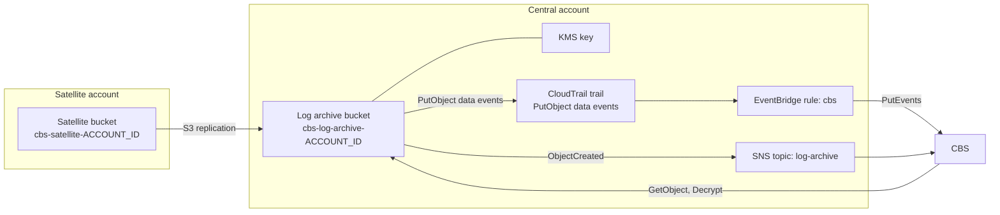

# Cloud Based Sensor

Infrastructure to support the Canadian Centre for Cyber Security (CCCS) Cloud Based Sensor (CBS) integration with AWS accounts.  The flow is as follows:

1. Each AWS satellite account has an S3 bucket (`cbs-satellite-<account_id>`) that collects service and access logs.  Objects are kept for 14 days.
1. This satellite bucket replicates its objects to the central log archive bucket (`cbs-log-archive-<log_archive_account_id>`) using the `CbsSatelliteReplicateToLogArchive` role.  Objects are kept for 90 days and encrypted with a KMS key owned by the central account.
1. CBS gets notified of new objects and pulls them from the log archive bucket to scan for threats:
    - An SNS topic (`log-archive`) receives `s3:ObjectCreated:*` notifications from the log archive bucket.
    - An EventBridge rule (`cbs`) matches `PutObject` events written by S3 replication and forwards them to the CBS destination event bus (required for CBS v2.3).
    - A CloudTrail trail (`cbs-audit-replication-data-events`) logs `PutObject` data events on the log archive bucket so that the EventBridge rule keeps firing.
    - CBS reads objects using the principal in `cbs_principal_role_arn` or by assuming the `CbsASEAReaderRole` role.

This repo uses Terraform and Terragrunt to define and manage the satellite and central account AWS resources.

# How it works


## Satellite accounts
- AWS services (CloudTrail, load balancers, VPC flow logs, WAF and similar) write their logs to the satellite bucket.  The bucket policy only allows these writers and denies non-TLS access.
- Replication is configured with the `CbsSatelliteReplicateToLogArchive` role.  Objects are re-encrypted with the log archive KMS key (`log_archive_kms_key_arn`) and ownership is translated to the destination account.
- Satellite buckets are versioned, log access to a `-access` bucket, and delete objects after 14 days.

## Central account
- The log archive bucket accepts replicated objects only from the role ARNs derived from [`satellite_accounts`](./satellite_accounts) plus two Control Tower replication roles.  The same list is trusted by the log archive KMS key.
- Objects expire after 90 days.  Access logs for the bucket go to a `-access` bucket.
- CBS can read the bucket through its principal (`cbs_principal_role_arn`) or by assuming `CbsASEAReaderRole`.  Both need `kms:Decrypt` on the log archive key.
- Replication writes show up as `PutObject` calls by an `s3-replication` principal.  The trail in [`cloudtrail.tf`](./terragrunt/aws/central_account/cloudtrail.tf) records these as data events so the `cbs` EventBridge rule can match them and forward them to the CBS event bus using the `event-bus-invoke-remote-event-bus` role.
- The trail is separate from Control Tower's baseline trail so landing zone updates do not remove it.  Its log files go to their own bucket, encrypted with a dedicated KMS key.

## Terraform execution
- GitHub Actions authenticates to the central account with OIDC (`ConfigTerraformAdministratorRole` for apply, `ConfigTerraformReadOnlyRole` for plan).
- For satellite accounts, Terragrunt then assumes `ConfigTerraformAdminExecutionRole` in each account listed in `satellite_accounts`, using the session name `CBSGitHubActions`.  The trust policies check the session name.
- State is stored in S3 (`cbs-<account_id>-tfstate`) with the `tfstate-lock` DynamoDB table, where `<account_id>` comes from `get_aws_account_id()` in [`terragrunt/env/terragrunt.hcl`](./terragrunt/env/terragrunt.hcl).

# Repository layout
| Path | Description |
| --- | --- |
| [`bootstrap/`](./bootstrap) | One-time Terraform used to create the initial IAM roles in each account.  See the [bootstrap README](./bootstrap/README.md). |
| [`terragrunt/aws/central_account`](./terragrunt/aws/central_account) | Central account module: log archive bucket, KMS keys, SNS topic, EventBridge rule, CloudTrail trail, IAM roles. |
| [`terragrunt/aws/satellite_bucket`](./terragrunt/aws/satellite_bucket) | Satellite account module: satellite bucket, replication configuration and replication role policy. |
| [`terragrunt/env`](./terragrunt/env) | Terragrunt configuration for each module.  [`terragrunt.hcl`](./terragrunt/env/terragrunt.hcl) holds the shared inputs, S3 remote state and generated provider config. |
| [`satellite_accounts`](./satellite_accounts) | List of satellite account IDs.  Used by the central account (replication role trust) and as the matrix for the satellite workflows. |
| [`.github/workflows`](./.github/workflows) | Terragrunt plan/apply workflows and repository housekeeping. |

All resources are deployed to `ca-central-1`.

# Configuration
Shared inputs are set in [`terragrunt/env/terragrunt.hcl`](./terragrunt/env/terragrunt.hcl):

| Input | Value |
| --- | --- |
| `log_archive_account_id` | Account that hosts the log archive bucket and central resources |
| `log_archive_bucket_name` | `cbs-log-archive-<log_archive_account_id>` |
| `satellite_bucket_name` | `cbs-satellite-<account_id>` |
| `satellite_s3_replicate_role_name` | `CbsSatelliteReplicateToLogArchive` |
| `satellite_account_ids` | Parsed from the [`satellite_accounts`](./satellite_accounts) file |
| `billing_tag_value` | `cbs-<account_id>` |

Module specific inputs:
- Central: `cbs_transport_lambda_name` is set in [`terragrunt/env/central/central_account/terragrunt.hcl`](./terragrunt/env/central/central_account/terragrunt.hcl).  `cbs_principal_role_arn` and `cbs_destination_event_bus_arn` have no default and are passed as `TF_VAR_` environment variables from GitHub secrets.
- Satellite: `log_archive_kms_key_arn` is set in [`terragrunt/env/satellite/satellite_bucket/terragrunt.hcl`](./terragrunt/env/satellite/satellite_bucket/terragrunt.hcl).  It must be updated if the log archive key is ever replaced.

# Setup
Install Terraform, Terragrunt, the AWS CLI and `jq`.  The versions used in CI are set in the workflow files, and a [devcontainer](./.devcontainer/devcontainer.json) is provided.

We use a bootstrap pattern to onboard new accounts so that we can create the OpenID Connect IAM roles that are used by our [Terraform GitHub Actions](./.github/workflows).  The following is only required once per account.

## Central account
1. Export an AWS access key for the central account.
1. Run [`./bootstrap/central_account_iam/bootstrap.sh`](./bootstrap/central_account_iam/bootstrap.sh).  This creates the `ConfigTerraformAdministratorRole` role, trusted by GitHub Actions OIDC on the `main` branch.
1. Run `terragrunt init` in [`./terragrunt/env/central/central_account`](./terragrunt/env/central/central_account).
1. Import the bootstrapped role and IAM identity provider to the Terraform state:
```sh
terragrunt import \
    module.gh_oidc_roles.aws_iam_role.this[0] \
    ConfigTerraformAdministratorRole
terragrunt import \
    module.gh_oidc_roles.aws_iam_openid_connect_provider.github \
    ${GITHUB_OIDC_PROVIDER_ARN}
```

The central account Terraform also manages the `ConfigTerraformReadOnlyRole` role, which is used by the plan workflows and is not bootstrapped.

## Satellite account
1. Export an AWS access key for the satellite account.
1. Run [`./bootstrap/satellite_account_iam/bootstrap.sh`](./bootstrap/satellite_account_iam/bootstrap.sh).  This creates:
    - `ConfigTerraformAdminExecutionRole`, assumed by the central account's `ConfigTerraformAdministratorRole` (session name `CBSGitHubActions`) for apply.
    - `ConfigTerraformReadOnlyExecutionRole`, assumed by the central account's `ConfigTerraformReadOnlyRole` (session name `CBSGitHubActions`) for plan.
    - `CbsSatelliteReplicateToLogArchive`, the role used by S3 replication.  Its permissions are attached by [`terragrunt/aws/satellite_bucket`](./terragrunt/aws/satellite_bucket/iam.tf).
1. Create a Pull Request with the new account ID added to [`./satellite_accounts`](./satellite_accounts).  Merging the PR also updates the central account so the new replication role is trusted by the log archive bucket policy and KMS key.

# Deployment
Changes are planned on pull requests and applied on merge to `main`:

| Workflow | Target | Role used |
| --- | --- | --- |
| [`terragrunt-plan-central.yml`](./.github/workflows/terragrunt-plan-central.yml) | `terragrunt/env/central/central_account` | `ConfigTerraformReadOnlyRole` |
| [`terragrunt-apply-central.yml`](./.github/workflows/terragrunt-apply-central.yml) | `terragrunt/env/central/central_account` | `ConfigTerraformAdministratorRole` |
| [`terragrunt-plan-satellite.yml`](./.github/workflows/terragrunt-plan-satellite.yml) | `terragrunt/env/satellite/satellite_bucket`, once per account in `satellite_accounts` | `ConfigTerraformAdministratorRole`, then `ConfigTerraformAdminExecutionRole` in the satellite account |
| [`terragrunt-apply-satellite.yml`](./.github/workflows/terragrunt-apply-satellite.yml) | `terragrunt/env/satellite/satellite_bucket`, once per account in `satellite_accounts` | `ConfigTerraformAdministratorRole`, then `ConfigTerraformAdminExecutionRole` in the satellite account |

The central account workflows require the `CBS_PRINCIPAL_ROLE_ARN` and `CBS_DESTINATION_EVENT_BUS_ARN` repository secrets.

Run `make fmt` to format the Terraform files.

## Running Terragrunt locally
Plan from the relevant directory under [`terragrunt/env`](./terragrunt/env) with credentials for the central account.

```sh
# Central account
export TF_VAR_cbs_principal_role_arn=<role arn>
export TF_VAR_cbs_destination_event_bus_arn=<event bus arn>
cd terragrunt/env/central/central_account
terragrunt plan

# Satellite account
export TERRAGRUNT_IAM_ROLE=arn:aws:iam::<satellite account id>:role/ConfigTerraformAdminExecutionRole
export TERRAGRUNT_IAM_ASSUME_ROLE_SESSION_NAME=CBSGitHubActions
cd terragrunt/env/satellite/satellite_bucket
terragrunt plan
```

## Verifying replication
1. Upload a test object to the satellite bucket and check that it appears in the log archive bucket.  Check the replication status with `aws s3api head-object` (`ReplicationStatus` should be `COMPLETED`).
1. Check the `cbs` EventBridge rule metrics (`Invocations` and `FailedInvocations`) to confirm the event was forwarded.
1. If delivery to the trail's log bucket fails, check `aws cloudtrail get-trail-status --name cbs-audit-replication-data-events` for `LatestDeliveryError`.

# Log archive structure
**Note:** Cloudtrail logs are now centralized in the `o-gfiiyvq1tj` folder. This is the central Log Archive bucket name that all accounts log their Cloudtrail data to when they are created. After April 2022 the `cloudtrail_logs` folder will be empty as we only keep data for 14 days and no new data will be sent.

```
cbs-log-archive-bucket/
├─ [cloudtrail_logs]/
│  ├─ [AWSLogs]/
│  │  ├─ [aws_account_id]
│  │  │  ├─ file
│  │  │  ├─ ...
│  │  │  
├─ [lb_logs]/
│  ├─ [AWSLogs]/
│  │  ├─ [aws_account_id]
│  │  │  ├─ file
│  │  │  ├─ ...
│  │  │  
├─ [o-gfiiyvq1tj]/
│  ├─ [AWSLogs]/
│  │  ├─ [aws_account_id]
│  │  │  ├─ file
│  │  │  ├─ ...
│  │  │ 
├─ [vpc_flow_logs]/
│  ├─ [AWSLogs]/
│  │  ├─ [aws_account_id]
│  │  │  ├─ file
│  │  │  ├─ ...
│  │  │  
├─ [waf_acl_logs]/
│  ├─ [AWSLogs]/
│  │  ├─ [aws_account_id]
│  │  │  ├─ file
│  │  │  ├─ ...
```
